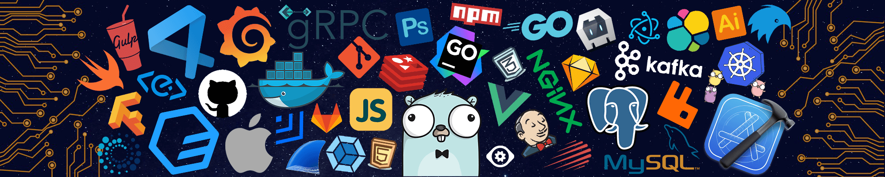

  

  

# Amruth L P

### Full-Stack Developer | MERN Stack | Python & Django
📍 **Bengaluru, India 🇮🇳**

Passionate full-stack developer experienced in building scalable web applications, business platforms, and developer tooling. Dedicated to writing clean, maintainable code and sharing practical technical knowledge.

  
  
  
  
  
  
  
  

---

## 💫 About Me

- 💻 **Professional Experience:** Full-stack development background, including work as a Full Stack Java Developer at Matrical Technologies, freelance software development, and engineering internships.
- ⚛️ **Core Specialization:** Building production-ready applications with the **MERN stack** (JavaScript, React, Node.js, Express, MongoDB) and RESTful API integrations.
- 🐍 **Active Focus & Growth:** Deepening expertise in **Python, Django, PostgreSQL**, database design, and modern application architecture.
- 🔭 **Current Work:** Developing institutional management platforms, ERP systems, and multilingual content management solutions.
- 📝 **Technical Writing & Video:** Publishing engineering guides on [Techno Drishti](https://technodrishti.vercel.app/) and authoring practical tutorials on **CodeWithAmruth**.
- 📄 **Resume & Credentials:** Find my verified experiences on my [Personal Portfolio](https://amruthlp.vercel.app/) or view my [Resume (PDF)](https://amruthlp.vercel.app/amruth_resume.pdf).

---

## 🚀 Featured Projects

<table>
  <tr>
    <td width="50%" valign="top">
      <h3>🏛️ Institutional CMS</h3>
      
A modular management system designed for institutional administration, supporting structured content, translation workflows, and role-based permissions.

      

        
        
        
      

      

        <a href="https://github.com/AmruthLP12/institutional-cms"><b>View Repository →</b></a>
      

    </td>
    <td width="50%" valign="top">
      <h3>📰 Techno Drishti (Tech Blog)</h3>
      
A high-performance technical blog and documentation portal focusing on web engineering, backend best practices, Linux, and developer workflows.

      

        
        
        
      

      

        <a href="https://technodrishti.vercel.app/"><b>Visit Website →</b></a>
      

    </td>
  </tr>
  <tr>
    <td width="50%" valign="top">
      <h3>🧩 shadcnui-addon</h3>
      
An open-source, customizable UI component addon library created to enhance modern React and Next.js applications using <code>shadcn/ui</code>.

      

        
        
        
      

      

        <a href="https://github.com/AmruthLP12/shadcnui-addon"><b>View Repository →</b></a>
      

    </td>
    <td width="50%" valign="top">
      <h3>🌍 Nations-Hub</h3>
      
Interactive web application providing comprehensive geographic metrics, demographic statistics, and flag data through responsive REST API consumption.

      

        
        
        
      

      

        <a href="https://github.com/AmruthLP12/Nations-Hub"><b>View Repository →</b></a>
      

    </td>
  </tr>
</table>

---

## 🛠️ Tech Stack & Tooling

### Core Technologies

  

  
<b>🔍 View Full Categorized Technology Inventory (Click to Expand)</b>

   

  | Category | Technologies & Tools |
  | :--- | :--- |
  | **Languages & Markup** |  |
  | **Frontend Frameworks & Libraries** |     |
  | **Backend Frameworks & APIs** |     |
  | **Databases & Data Management** |   |
  | **CMS & Content Platforms** |  |
  | **Cloud, Hosting & Deployment** |   |
  | **Web Servers & Infrastructure** |    |
  | **Developer Tools & Version Control** |     |
  | **Mobile Development** |  |
  | **Data Analysis & Visualization** |    |
  | **Security & Privacy** |  |

---

## 🎥 Content & Technical Writing

### CodeWithAmruth
> **Build. Learn. Deploy.**

Through **CodeWithAmruth**, I create practical, project-driven programming tutorials and developer guides. Core topics include:
- Deep dives into **Django architecture** (Signals, custom managers, ReportLab dynamic PDF generation).
- Modern frontend integration with backend templates using **Tailwind CSS & DaisyUI**.
- Clean full-stack patterns, API design, and deployment practices.

📺 **YouTube Channel:** [@CodeWithAmruth](https://www.youtube.com/@CodeWithAmruth)

### ✍️ Technical Blog — Techno Drishti
I publish technical walkthroughs, developer tutorials, and architecture notes on [Techno Drishti](https://technodrishti.vercel.app/), documenting real-world problem-solving across web development and DevOps.

---

## 📊 GitHub Analytics

<table>
  <tr>
    <td align="center">
      
      
    </td>
    <td align="center">
      
      
    </td>
  </tr>
</table>

  
<b>🔥 View Contribution Streak Statistics</b>

   
  

    
    
  

---

## 🤝 Let's Connect

I am always keen to collaborate on impactful software projects, discuss modern web technologies, and connect with fellow developers.

  
  
  
  
  

### 💡 Philosophy
> *"Build things that solve real problems. Keep learning. Share what you know. Improve with every iteration."*

  
  

